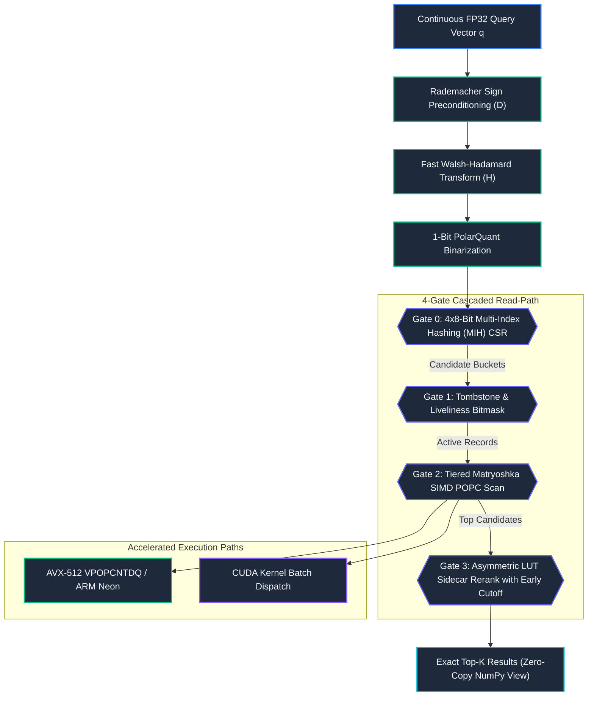

# Pithos Architectural Principles & Core Innovations

This document details the mathematical, algorithmic, and hardware-co-design principles underlying the Pithos Vector Search Engine.

---

## System Overview

Pithos operates as a **Model-Isomorphic Vector Database (MIDB)** where off-heap memory structures mirror the mathematical geometry of the embedding models:

---

## 1. Isomorphic Transformation & Matryoshka Tiers

Before binarization, raw input embeddings are transformed using a structured orthogonal mapping designed to preserve angular distance geometry:

- **Rademacher Preconditioning ($\mathbf{D}_{\mathrm{pre}}$):** A stochastic sign-flipping diagonal operator that whitens coordinate covariance:

    $$
    \mathbf{D}_{\mathrm{pre}} = \text{diag}(d_1, \dots, d_D) \quad \text{where } d_j \in \{-1, 1\} \text{ are independent Rademacher signs.}
    $$

    For an input vector $\mathbf{x} \in \mathbb{R}^D$, preconditioning is computed as the Hadamard elementwise product:

    $$
    \mathbf{x}' = \mathbf{x} \odot \mathbf{d}
    $$

- **Block-Diagonal Walsh-Hadamard Rotation ($\mathbf{H}_{\mathrm{BD}}$):** Rotation is computed as a direct sum of independent normalized Sylvester-Hadamard matrices corresponding to Matryoshka tier widths $\Delta s_k = s_k - s_{k-1}$:

    $$
    \mathbf{H}_{\mathrm{BD}} = \bigoplus_{k=1}^T \mathbf{H}_{\Delta s_k}
    $$

    where each Sylvester-Hadamard matrix $\mathbf{H}_n$ is normalized by $1/\sqrt{n}$ to remain orthogonal, and is recursively defined as:

    $$
    \mathbf{H}_{2^m} = \frac{1}{\sqrt{2}} \begin{bmatrix} \mathbf{H}_{2^{m-1}} & \mathbf{H}_{2^{m-1}} \\ \mathbf{H}_{2^{m-1}} & -\mathbf{H}_{2^{m-1}} \end{bmatrix} \quad \text{with } \mathbf{H}_1 = [1].
    $$

- **Kronecker Orthogonal Rotation for Composite Dimensions ($\mathbf{R} = \mathbf{H}_u \otimes \mathbf{\Omega}_v$):** When a tier width $w$ is not a power of two, `TransformOperator` factors $w = u \cdot v$ (with $u$ the largest power-of-two divisor and $v$ the odd residual) and applies an orthonormal $v \times v$ DCT-II transform followed by a size-$u$ FWHT using thread-local scratch buffers (`KRONECKER_SCRATCH`). Arbitrary non-64-aligned tier boundaries are sliced bit-accurately via `TransformOperator.extractTierWord()`.

---

## 2. Row-Norm Cumulative Energy Pruning

At load time, Pithos can ingest the embedding model's projection/LoRA weight matrix $\mathbf{W} \in \mathbb{R}^{D \times D_0}$. Instead of applying an SVD axis permutation that would break Matryoshka prefix alignment, `TransformOperator.computeCumulativeEnergy` evaluates the squared L2 energy of each coordinate row $i$ directly via Java Vector API FMA instructions:

$$
e_i = \sum_{j=1}^{D_0} W_{i,j}^2, \qquad \Phi(k) = \frac{\sum_{i=1}^{k} e_i}{\sum_{i=1}^{D} e_i}
$$

Given an energy budget $\tau \in (0, 1]$, Pithos computes the pruning tier boundary:

$$
\mathcal{T}(S,\tau) = \min \{ k \mid \Phi(s_k) \ge \tau \}
$$

All database columns matching tiers $k > \mathcal{T}(S,\tau)$ are bypassed during Gate 2 scanning, saving memory bus I/O bandwidth while preserving exact Matryoshka coordinate alignment.

---

## 3. Four-Gate Cascaded Read-Path

Query vectors cascade through four hardware-aligned evaluation gates:

### Gate 0: 4x8-Bit Multi-Index Hashing (MIH) CSR
- Partitions the first 64-bit word of the binarized vector into four independent 8-bit sub-words.
- Evaluates direct-mapped inverted CSR posting lists across exact buckets and 1-bit Hamming neighbors.
- Prunes $98.5\%$ to $99.2\%$ of the database in $O(1)$ sub-microsecond time.
- Fully backward-compatible: falls back gracefully to parallel linear scan for legacy v1.2.1 indices.

### Gate 1: Tombstone & Liveliness Bitmask
- Evaluates 64-bit metadata bitmasks in zero clock cycles.
- Instantly skips deleted ($T_i = 1$) or inactive records ($M_i = 0$) prior to accessing vector memory.

### Gate 2: Tiered Matryoshka SIMD POPC Scan
- Computes partial Hamming distances tier-by-tier across active candidates using AVX-512 `VPOPCNTDQ` or ARM Neon intrinsics:

    $$
    \mathcal{D}_H^{(k)}(\mathbf{b}_i, \mathbf{b}_q) = \sum_{d=1}^{s_k} b_{i,d} \oplus b_{q,d}
    $$

- Collects the top-$K_{\text{candidate}}$ records for precision refinement.

### Gate 3: Precision Sidecar Reranking with Monotonic Early Cutoff
- Maps candidate vectors directly from **FP8 (E4M3)** (`"space": "wht"`), **NVFP4 (E2M1)** (`"space": "wht"`), or **FP16** (`"space": "raw"`) sidecar memory, or falls back to asymmetric rotated L2 distance estimation on 1-bit/2-bit columns when `SidecarMode.NONE` is active.
- Uses precomputed continuous query Look-Up Tables (LUTs) in L1 cache for FP8 evaluation (zero floating-point multiplications in the inner loop).
- Breaks Euclidean distance accumulation immediately when the monotonic partial sum exceeds the current $k$-th best candidate distance $\tau_k$, preserving exact top-$k$ ordering among Gate 3 candidates while reducing dimension evaluations.

---

## 4. Multi-Family Resonant Voting

For multi-archetype consensus verification and high-confidence anomaly filtering, Pithos implements a lock-free multi-family resonant voting schema. Given a set of queries $Q = \{q_1, \dots, q_M\}$ split into $F$ families (each query $q_j$ assigned family $f_j \in \{0, \dots, F-1\}$ and threshold $T_j$):

- Each worker thread builds a thread-local bitmask of resonant family votes $V_i$ for record $i$:

    $$
    V_i = \bigvee_{j=1}^M \mathbb{I}\!\left( \mathcal{D}_H^{(T)}(\mathbf{b}_i, \mathbf{b}(q_j)) \le T_j \right) \cdot 2^{f_j}
    $$

- The thread-local bitmasks are merged across worker pools using a bitwise OR operation:

    $$
    V_i^{\text{merged}} = \bigvee_{w=1}^{N_{\text{workers}}} V_{i,w}
    $$

- A record $i$ is returned as a resonant match if the total number of families voting for it meets the vote threshold $K_{\text{vote}}$:

    $$
    \text{popcount}(V_i^{\text{merged}}) \ge K_{\text{vote}} \quad \text{where } K_{\text{vote}} = 5 \text{ (out of } F=8 \text{ families).}
    $$

---

## 5. Multi-Layer Zero-Overhead Security Model

Pithos incorporates defense-in-depth security mechanisms designed to provide maximum robustness without introducing any runtime branching or latency penalties in the SIMD search hot-path:

1. **Defensive C-API Pointer Guards:**
   All entry points in `CApi.java` validate external client pointers (`name`, `path`, `query`, `outIds`, `outDistances`) and scalar ranges ($k > 0$, $D \in [1, 65536]$) in $< 0.2\,\text{ns}$ before Java memory slicing, preventing `SIGSEGV` segmentation faults and memory corruption from untrusted caller environments.

2. **Superblock & Container Slicing Bounds Verification:**
   During container mounting, all section offsets and lengths are verified against physical `FileChannel.size()`. Files with tampered or forged offsets are safely rejected before memory slicing. The Table of Contents (TOC) is limited to 50 MB to prevent memory exhaustion payloads.

3. **Path Traversal & Filesystem Sanitization:**
   Index names and filepaths are canonicalized via `Path.normalize()`, blocking directory traversal (`../`) and null-byte injection attacks.

4. **Multi-Tenant Memory Isolation:**
   All thread-local query scratch buffers (`VISITED_SCRATCH`) are deterministically zero-wiped before and after query execution, ensuring zero cross-tenant data leakage on shared worker threads.

