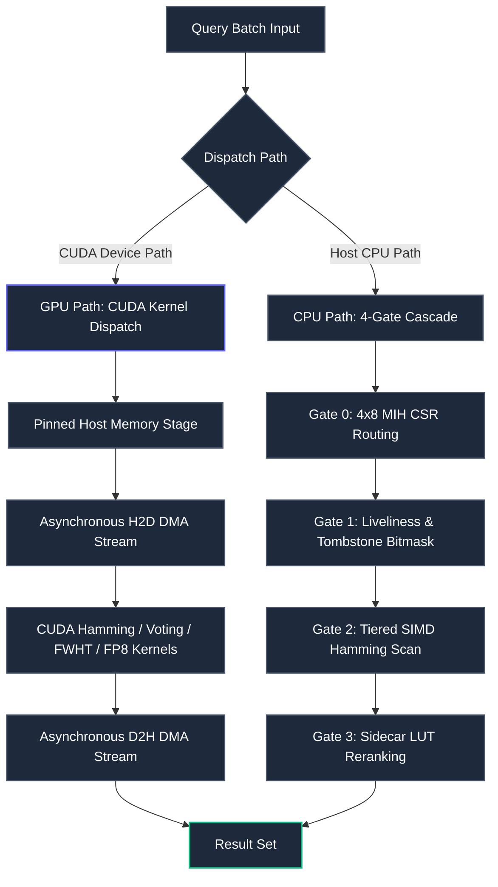

# Pithos CUDA GPU Acceleration & Hybrid Engine

*High-Performance GPU-Accelerated Vector Search for NVIDIA Grace Blackwell, Hopper & Ampere*

---

## Executive Summary

This document details the architecture and implementation of **NVIDIA CUDA GPU acceleration** within Pithos. Modern GPUs provide massive parallel computational throughput for high-throughput batch vector retrieval workloads. Pithos employs a **hybrid CPU-GPU co-design** combining the strengths of both processing architectures:

- **CPU (Host Path):** Ultra-low latency single-query evaluation, zero-copy off-heap memory mapping (`mmap`), and the 4-gate cascaded read-path.
- **GPU (Device Path):** Parallel throughput for batch query evaluation via fused bitwise XOR-popcount Hamming kernels, Fast Walsh-Hadamard Transforms (FWHT), FP8 reranking kernels, and multi-family resonant voting.

---

## Workload Acceleration Analysis

### High Priority: GPU-Optimized Operations

| Operation | Complexity | Implementation | Priority |
| :--- | :--- | :--- | :--- |
| **Batch Hamming Distance** | $O(N \times W \times Q)$ | `batch_hamming_distance_kernel` / `batch_hamming_optimized_kernel` | High |
| **Multi-Family Resonant Voting** | $O(N \times W \times Q)$ | `multi_family_voting_kernel` | High |
| **Walsh-Hadamard Transform** | $O(D \log D)$ | `launch_walsh_hadamard_kernel` | Medium |
| **FP8 Batch Reranking** | $O(N \times D \times Q)$ | `launch_batch_rerank_fp8_kernel` | Medium |

### CPU-Optimized Operations (GPU Bypass)

| Operation | Rationale for CPU Execution |
| :--- | :--- |
| **Single-Query KNN** | PCIe transfer latency exceeds host 4-gate evaluation time |
| **Index Compilation** | One-time asynchronous operation; CPU with multi-threading is optimal |
| **Metadata & Validity Bitmask** | Instant bitmask checks in Gate 1 on CPU |
| **Liveliness & Tombstone Checks** | Direct 64-bit mask evaluation on host without VRAM staging |
| **Weight Row-Norm Energy Computation** | One-time $O(D \cdot D_0)$ initialization during model weight loading (`TransformOperator.computeCumulativeEnergy`) |

---

## Architecture: Hybrid CPU-GPU Design



### Memory Hierarchy

```
┌─────────────────────────────────────────────────────────────┐
│                      GPU Memory (VRAM)                      │
│  ┌─────────────────┐  ┌─────────────────┐  ┌─────────────┐  │
│  │ Device Buffers  │  │ CUDA Kernels    │  │ Shared Mem  │  │
│  │ (Tier Columns)  │  │ (Hamming, Voting│  │ (Warps/Tile)│  │
│  └─────────────────┘  └─────────────────┘  └─────────────┘  │
└─────────────────────────────────────────────────────────────┘
                          ▲
                          │ 900 GB/s NVLink-C2C / PCIe Gen5 DMA
                          ▼
┌─────────────────────────────────────────────────────────────┐
│                     Host Memory (DRAM)                      │
│  ┌─────────────────┐  ┌─────────────────┐  ┌─────────────┐  │
│  │ mmap Columns    │  │ Pinned Memory   │  │ GraalVM /   │  │
│  │ (POSIX Off-Heap)│  │ (Async Streams) │  │ Native FFM  │  │
│  └─────────────────┘  └─────────────────┘  └─────────────┘  │
└─────────────────────────────────────────────────────────────┘
```

---

## Build Pipeline & Kernel Interfaces

### 1. Maven CUDA Profile (`pom.xml`)

Build with the `-Pcuda` profile and `-Dcuda.enabled=true`. Maven compiles `src/main/cuda/pithos_kernels.cu` and `src/main/cuda/pithos_cuda_memory.cu` with `nvcc` (`-arch=sm_80`) alongside the C JNI bridge sources in `src/main/c/` and links them directly into the GraalVM native shared library:

```bash
mvn clean package -Pcuda -Dcuda.enabled=true -DskipTests
```

### 2. CUDA Kernel Header (`src/main/cuda/pithos_kernels.h`)

```c
int launch_batch_hamming_kernel(
    const uint64_t* db_vectors,
    const uint64_t* query_vectors,
    int* distances,
    int num_db_vectors,
    int num_queries,
    int num_tiers,
    const int* tier_offsets,
    const int* tier_sizes,
    cudaStream_t stream
);

int launch_batch_hamming_optimized_kernel(
    const uint64_t* db_vectors,
    const uint64_t* query_vectors,
    int* distances,
    int num_db_vectors,
    int num_queries,
    int num_words_per_vector,
    cudaStream_t stream
);

int launch_multi_family_voting_kernel(
    const uint64_t* db_vectors,
    const uint64_t* query_vectors,
    const int* families,
    const int* thresholds,
    uint8_t* voting_mask,
    int num_db_vectors,
    int num_queries,
    int num_families,
    int num_words_per_vector,
    cudaStream_t stream
);

int launch_walsh_hadamard_kernel(
    float* input,
    float* output,
    int num_vectors,
    int dimension,
    cudaStream_t stream
);

int launch_batch_rerank_fp8_kernel(
    const uint8_t* db_fp8_vectors,
    const float* query_vectors,
    float* out_distances,
    int num_db_vectors,
    int num_queries,
    int dimension,
    cudaStream_t stream
);
```

### 3. Host Wrapper Interface (`src/main/c/pithos_cuda.h`)

```c
int pithos_cuda_init(int deviceId);
int pithos_cuda_shutdown(void);
int pithos_cuda_is_available(void);
int pithos_cuda_get_device_count(void);
int pithos_cuda_alloc_pinned(void** ptr, size_t size);
int pithos_cuda_free_pinned(void* ptr);
int pithos_cuda_alloc_device(void** ptr, size_t size);
int pithos_cuda_free_device(void* ptr);
int pithos_cuda_copy_to_device_async(void* dst, void* src, size_t size, void* stream);
int pithos_cuda_copy_from_device_async(void* dst, void* src, size_t size, void* stream);
int pithos_cuda_stream_synchronize(void* stream);
int pithos_cuda_launch_batch_hamming(
    const uint64_t* db_vectors,
    const uint64_t* query_vectors,
    int* distances,
    int num_db_vectors,
    int num_queries,
    int num_tiers,
    const int* tier_offsets,
    const int* tier_sizes
);
int pithos_cuda_launch_voting(
    const uint64_t* db_vectors,
    const uint64_t* query_vectors,
    const int* families,
    const int* thresholds,
    uint8_t* voting_mask,
    int num_db_vectors,
    int num_queries,
    int num_families,
    int num_words_per_vector
);
```

---

### Core CUDA Kernel Example (`src/main/cuda/pithos_kernels.cu`)

```cuda
__global__ void batch_hamming_optimized_kernel(
    const uint64_t* db_vectors,
    const uint64_t* query_vectors,
    int* distances,
    const int num_db_vectors,
    const int num_queries,
    const int num_words_per_vector
) {
    const int query_idx = blockIdx.y;
    const int db_idx = blockIdx.x * blockDim.x + threadIdx.x;

    if (db_idx >= num_db_vectors || query_idx >= num_queries) {
        return;
    }

    extern __shared__ uint64_t shared_query[];

    if (threadIdx.x < num_words_per_vector) {
        shared_query[threadIdx.x] = query_vectors[query_idx * num_words_per_vector + threadIdx.x];
    }
    __syncthreads();

    int total_distance = 0;
    for (int w = 0; w < num_words_per_vector; w++) {
        const uint64_t db_word = db_vectors[db_idx * num_words_per_vector + w];
        total_distance += __popcll(db_word ^ shared_query[w]);
    }

    distances[db_idx * num_queries + query_idx] = total_distance;
}
```

---

## Verification & Testing

Execute GPU unit tests (`CudaKernelTest`) or build the full CUDA container image:

```bash
# 1. Run Java unit tests with CUDA enabled (requires NVIDIA CUDA GPU & Toolkit)
mvn test -Pcuda -Dcuda.enabled=true

# 2. Build complete CUDA GraalVM native library inside Docker
docker build -f Dockerfile.cuda --target builder -t pithos-cuda-builder .
```
