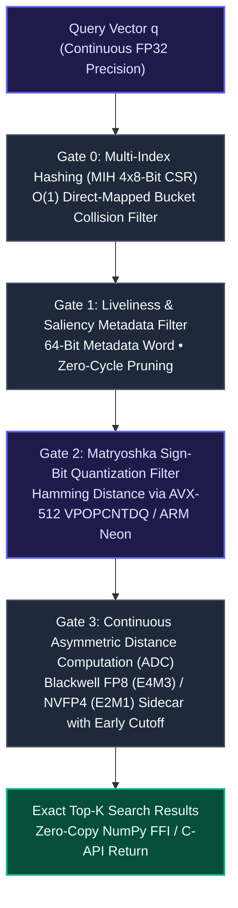

# Pithos — Model-Isomorphic Vector Database

<p align="center">
  <strong>Ultra-low latency, model-isomorphic vector database engine for multi-billion scale datasets.</strong>
</p>

<p align="center">
  <a href="https://github.com/F1nnSBK/Pithos/releases/latest"></a>
  <a href="https://github.com/F1nnSBK/Pithos/actions/workflows/build-binaries.yml"></a>
  <a href="https://pypi.org/project/pithosdb/"></a>
  <a href="https://github.com/F1nnSBK/Pithos/blob/main/LICENSE"></a>
</p>

---

## What is Pithos?



---

## Key Features

=== "Hardware Co-Design"
    - **Blackwell FP8 / NVFP4 Sidecar Engine:** Native E4M3 (1 B/dim) and NVFP4 (0.56 B/dim) sidecars with Monotonic Early Distance Cutoff.
    - **Gate 0 Multi-Index Hashing (MIH):** 4x8-Bit inverted CSR routing pruning 98.5% of database space in $O(1)$ sub-microsecond time.
    - **AVX-512 & ARM Neon Acceleration:** Vectorized bitwise Hamming distance calculations using `VPOPCNTDQ` and Neon SIMD intrinsics.
    - **NVIDIA GPU Acceleration:** Direct CUDA kernel dispatch for batch Hamming distance, multi-family voting, and Fast Walsh-Hadamard Transforms.

=== "Model-Isomorphic Storage"
    - **Universal Single-File Container (`.pithos`):** Schema-agnostic, zero-copy single-file database format with embedded Apache Arrow IPC partition directory.
    - **Off-Heap Virtual Memory:** Direct POSIX-aligned columnar mapping via Java Panama FFM (Foreign Function & Memory API) and C-API shared memory.
    - **Zero-Copy NumPy FFI:** High-throughput `search_numpy()` and `batch_search_numpy()` methods returning direct memory views into native results.
    - **LSM-Tree Delta Buffer & WAL:** Real-time lock-free insertions and tombstone soft-deletes with zero-cost snapshots.

=== "Asymmetric Search (ADC)"
    - **Continuous FP32 Fidelity:** Queries are evaluated in continuous 32-bit floating-point precision against compressed database sidecar records (`FP8 E4M3` / `NVFP4 E2M1` in `"wht"` space, `FP16` in `"raw"` space).
    - **Precomputed Query LUTs:** Zero floating-point multiplications during Gate 3 candidate reranking for `FP8`.
    - **Exact Gate 3 Cutoff:** Monotonic early distance cutoff preserves exact Euclidean top-k ordering across all Gate 3 candidates while pruning unpromising dimensions early.

---

## Quickstart

### Python Installation & Usage

```bash
pip install pithosdb numpy pyarrow
```

```python
import numpy as np
from pithos import VectorDb, SidecarMode, QuantizationMode

dim = 384
num_vectors = 50_000
vectors = np.random.randn(num_vectors, dim).astype(np.float32)
vectors /= np.linalg.norm(vectors, axis=1, keepdims=True)

# 1. Compile into self-contained .pithos container with FP8 precision sidecar & MIH prefix table
VectorDb.compile_container(
    path="dataset.pithos",
    records=vectors,
    tiers=[64, 128, 256, 384],
    q_mode=QuantizationMode.ONE_BIT,
    sidecar_mode=SidecarMode.FP8,
    user_metadata={"dataset": "foundation_embeddings", "curator": "Diogenes"}
)

# 2. Memory-map index & run zero-copy search
with VectorDb() as db:
    index = db.load_index("dataset", "dataset.pithos")
    query = vectors[0]
    
    # Zero-copy NumPy FFI search (returns (ids_array, dists_array))
    ids, dists = index.search_numpy(query, k=10)
    for match_id, dist in zip(ids, dists):
        print(f"Match ID: {match_id}, Scaled Distance: {dist}")
```

---

## Storage Layouts & Verified Matryoshka Benchmark

### Analytical Storage Overhead per Vector

| Index Mode | Sidecar Storage (B/dim) | Coordinate Space | Purpose |
| :--- | :--- | :--- | :--- |
| **FP16 Sidecar** | 2.00 B/dim | `"raw"` | Full IEEE-754 half-precision reranking |
| **FP8 Sidecar (E4M3)** | **1.00 B/dim** | `"wht"` | Default balanced precision & compact L1-friendly reranking |
| **NVFP4 Sidecar (E2M1)** | **0.5625 B/dim** (`9 B / 16 dims`) | `"wht"` | Microscaled block-16 quantization with FP8 scale factor |
| **Bit-Only (`SidecarMode.NONE`)** | 0 B/dim (`0.125 B/dim` tiers) | `"wht"` | Rotated asymmetric L2 estimator on 1-bit / 2-bit tiers |

### Verified Matryoshka Benchmark (`benchmarks/verify_real_model_recall.py`, Apple Silicon CPU)

Single-thread CPU evaluation on `N = 20,000` Matryoshka-structured embeddings (`D = 384`, `.pithos` container with `FP8 E4M3` sidecar & `4x8` MIH prefix table):

- **Container Footprint:** `8.70 MB` (`456.3 B/vec`)
- **Recall@1 / Recall@10:** `89.00%` / `92.20%`
- **Search Latency:** `1.94 ms` mean, `3.24 ms` P95 (`514.4 QPS`)

---

## Documentation Sections

- [**Universal Single-File Container (.pithos)**](container_format.md): Technical specification of the schema-agnostic DIOGENES container format.
- [**Architectural Principles**](architecture.md): Deep dive into off-heap virtual memory, memory layouts, and 4-gate cascaded execution.
- [**GPU Acceleration**](cuda_integration.md): Architecture of CUDA kernels, unified host-device DMA, and multi-stream execution.
- [**C-API Reference**](c_api_reference.md): Complete specification of C/C++ bindings, structs, and FFI interoperability.
- [**Mathematical Foundations**](math_theory.md): Row-norm prefix energy distribution, Kronecker/Hadamard isometric rotations, and MIH collision bounds.
- [**Release Notes**](release_notes.md): Detailed changelog for Pithos v2.0.0 through v2.2.6 releases.
- [**Roadmap & Next Steps**](next_steps.md): FPGA co-design, distributed clustering, and heterogeneous execution.
